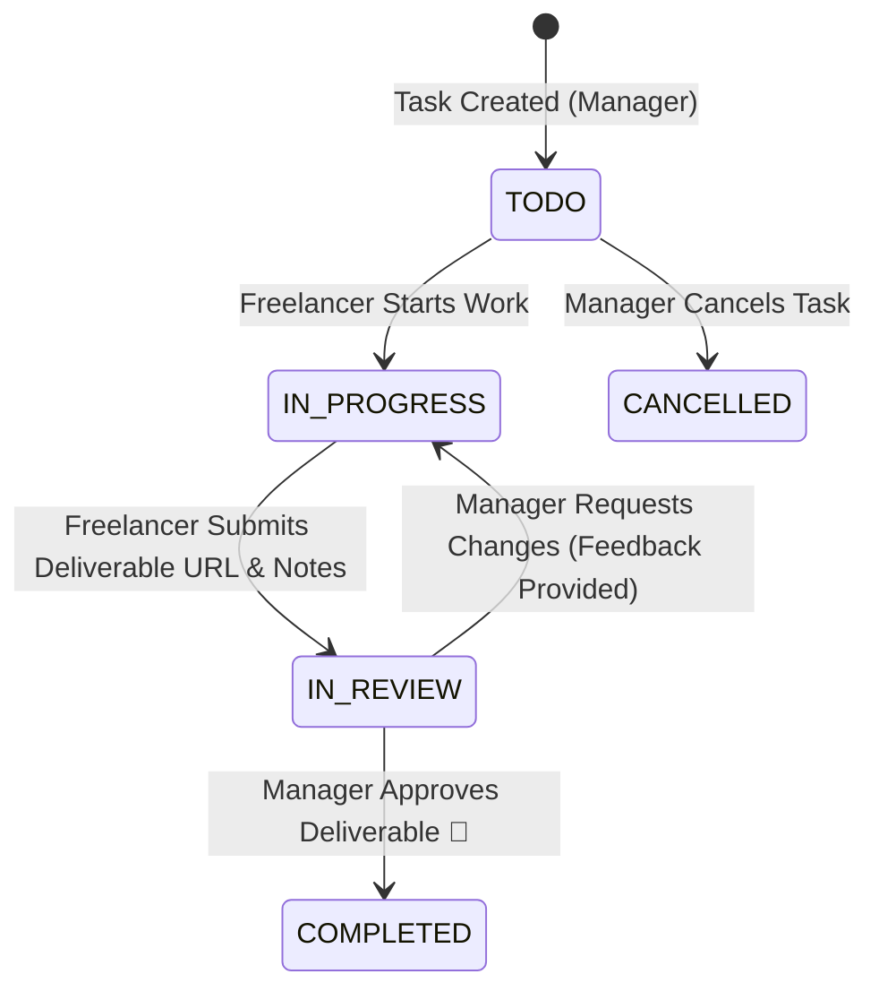

# Company-to-Company & Freelancer Collaboration — Frontend Integration Guide

## Overview

The **Company-to-Company & Freelancer Collaboration** feature allows Quorum organizations (`Organization`) to initiate cross-company projects (`Project`) and invite external partners, agencies, and freelancers (`User`) into a secure, sandboxed workspace.

### Core Pillars
1. **Dedicated Project Workspace & Real-Time Chat**: Every project automatically provisions an integrated group chat channel (`Conversation` linked via `projectId`).
2. **Task & Deliverable Lifecycle**: Full lifecycle tracking (`TODO` ➔ `IN_PROGRESS` ➔ `IN_REVIEW` ➔ `COMPLETED`) with deliverable file submissions and manager review/approval.
3. **Strict Sandboxing**: External collaborators are strictly confined to projects they are members of. They cannot view internal company teams, private employee directories, or confidential organization assets.
4. **Real-time Synchronization**: Socket.IO events and high-priority background push notifications for instant task updates, handoffs, and feedback.

---

## Roles & Permissions Matrix

| Capability | `PROJECT_MANAGER` | `INTERNAL_MEMBER` | `FREELANCER` | `CLIENT` |
| :--- | :---: | :---: | :---: | :---: |
| **View Project & Details** | ✅ | ✅ | ✅ | ✅ |
| **Workspace Chat & File Sharing** | ✅ | ✅ | ✅ | ✅ |
| **View Project Tasks** | ✅ | ✅ | ✅ | ✅ |
| **Create & Assign Tasks** | ✅ | ❌ | ❌ | ❌ |
| **Update Assigned Task Status** | ✅ | ✅ | ✅ | ❌ |
| **Submit Task Deliverables** | ✅ | ✅ | ✅ | ❌ |
| **Approve / Reject Deliverables** | ✅ | ❌ | ❌ | ❌ |
| **Invite External Collaborators** | ✅ | ❌ | ❌ | ❌ |
| **Remove Collaborators** | ✅ | ❌ | ❌ | ❌ |
| **Update / Delete Project** | ✅ | ❌ | ❌ | ❌ |

> **Note**: Organization Admins (`ORG_ADMIN`) of the hosting organization automatically inherit `PROJECT_MANAGER` privileges on all organization projects.

---

## Task & Deliverable Review Workflow



---

## REST API Reference

Base URL: `/api/projects` (also aliased under `/api/v1/projects`)  
All requests require: `Authorization: Bearer <access_token>`

---

### 1. Project Management

#### A. List User Projects
Retrieves all projects the authenticated user belongs to (as an internal member or external collaborator).
- **Method**: `GET`
- **Endpoint**: `/api/projects` *(or `/api/projects/my-projects`)*
- **Response (200 OK)**:
```json
{
  "success": true,
  "statusCode": 200,
  "message": "User projects retrieved successfully",
  "data": [
    {
      "id": "771b9db1-3eb2-419a-9e12-32a24681fb78",
      "name": "Mobile App V2 Redesign",
      "description": "Cross-company UI/UX overhaul",
      "status": "ACTIVE",
      "budget": 8000,
      "dueDate": "2026-12-15T00:00:00.000Z",
      "organization": {
        "id": "org_123",
        "name": "Acme Corp",
        "logo": "https://..."
      },
      "conversation": {
        "id": "conv_999",
        "name": "Mobile App V2 Redesign - Workspace"
      },
      "members": [
        {
          "role": "FREELANCER",
          "hourlyRate": 60,
          "companyName": "PixelCraft Studio",
          "user": {
            "id": "usr_freelancer",
            "name": "Alex Designer",
            "email": "alex@pixelcraft.io",
            "avatar": "https://..."
          }
        }
      ],
      "_count": {
        "tasks": 12,
        "members": 4
      }
    }
  ]
}
```

#### B. Create Project under Organization
Initiates a new project and automatically spawns its dedicated collaboration channel.
- **Method**: `POST`
- **Endpoint**: `/api/projects/organization/:organizationId` *(or `/api/projects/org/:organizationId`)*
- **Request Body**:
```json
{
  "name": "Mobile App V2 Redesign",
  "description": "Cross-company UI/UX overhaul",
  "budget": 8000,
  "dueDate": "2026-12-15T00:00:00.000Z"
}
```
- **Response (201 Created)**: Returns created `project` with linked `conversation`.

#### C. Get Project Details
- **Method**: `GET`
- **Endpoint**: `/api/projects/:id`
- **Response (200 OK)**: Full project details, members, and task summary.

#### D. Update Project Details
- **Method**: `PATCH`
- **Endpoint**: `/api/projects/:id`
- **Request Body**:
```json
{
  "name": "Mobile App V2 (Renamed)",
  "status": "ACTIVE",
  "budget": 9500,
  "dueDate": "2026-12-20T00:00:00.000Z"
}
```

#### E. Delete Project
- **Method**: `DELETE`
- **Endpoint**: `/api/projects/:id`
- **Response (200 OK)**: `{ "success": true, "message": "Project deleted successfully" }`

---

### 2. Invitations & Collaborator Management

#### A. Invite External Collaborator / Freelancer
Generates a secure 7-day invitation token and dispatches an invitation email and notification.
- **Method**: `POST`
- **Endpoint**: `/api/projects/:id/invites` *(or `/api/projects/:id/members/invite`)*
- **Request Body**:
```json
{
  "email": "alex@pixelcraft.io",
  "role": "FREELANCER",
  "hourlyRate": 60,
  "companyName": "PixelCraft Studio"
}
```
- **Available Roles**: `PROJECT_MANAGER`, `INTERNAL_MEMBER`, `FREELANCER`, `CLIENT`
- **Response (201 Created)**:
```json
{
  "success": true,
  "statusCode": 201,
  "message": "Project invite sent successfully",
  "data": {
    "id": "invite_uuid",
    "email": "alex@pixelcraft.io",
    "role": "FREELANCER",
    "token": "49f50e93...",
    "expiresAt": "2026-11-08T18:00:00.000Z"
  }
}
```

#### B. Accept Project Invitation
Validates the token, enlists the user as a `ProjectMember`, and admits them into the project chat room.
- **Method**: `POST`
- **Endpoint**: `/api/projects/accept-invite` *(or `/api/projects/invites/accept`)*
- **Request Body**:
```json
{
  "token": "49f50e93..."
}
```
- **Response (200 OK)**: Returns confirmed membership and project details.

#### C. Remove Collaborator from Project
- **Method**: `DELETE`
- **Endpoint**: `/api/projects/:id/members/:userId`
- **Response (200 OK)**: `{ "success": true, "message": "Project member removed successfully" }`

---

### 3. Task Management & Deliverable Workflow

#### A. List Project Tasks
- **Method**: `GET`
- **Endpoint**: `/api/projects/:id/tasks`
- **Query Parameters**:
  - `status`: Optional filter (`TODO`, `IN_PROGRESS`, `IN_REVIEW`, `COMPLETED`, `CANCELLED`)
  - `assigneeId`: Optional filter by assigned user UUID
- **Response (200 OK)**:
```json
{
  "success": true,
  "statusCode": 200,
  "message": "Project tasks retrieved successfully",
  "data": [
    {
      "id": "task_uuid",
      "title": "Design Onboarding Wireframes",
      "description": "Figma screens for signup and OTP verification",
      "priority": "HIGH",
      "status": "IN_REVIEW",
      "deliverableUrl": "https://s3.amazonaws.com/quorum/deliverables/wireframes.zip",
      "deliverableNote": "Final vector assets included in archive.",
      "assignee": {
        "id": "usr_freelancer",
        "name": "Alex Designer",
        "email": "alex@pixelcraft.io",
        "avatar": "https://..."
      },
      "dueDate": "2026-11-10T00:00:00.000Z"
    }
  ]
}
```

#### B. Create Project Task (Manager)
- **Method**: `POST`
- **Endpoint**: `/api/projects/:id/tasks`
- **Request Body**:
```json
{
  "title": "Design Onboarding Wireframes",
  "description": "Figma screens for signup and OTP verification",
  "priority": "HIGH",
  "assigneeId": "usr_freelancer",
  "dueDate": "2026-11-10T00:00:00.000Z"
}
```
- Automatically sends a high-priority background push notification to `assigneeId`.

#### C. Fast Status Progression (Freelancer / Assignee)
- **Method**: `PATCH`
- **Endpoint**: `/api/projects/:id/tasks/:taskId/status`
- **Request Body**:
```json
{
  "status": "IN_PROGRESS"
}
```

#### D. Submit Task Deliverable (Freelancer)
When work is ready for review, the freelancer submits the S3 asset URL and handoff notes.
- **Method**: `POST`
- **Endpoint**: `/api/projects/:id/tasks/:taskId/deliverable`
- **Request Body**:
```json
{
  "deliverableUrl": "https://s3.amazonaws.com/quorum/deliverables/wireframes.zip",
  "deliverableNote": "Final vector assets included in archive."
}
```
- **Result**: Task state transitions to `IN_REVIEW`. The project manager receives a push notification and real-time review alert.

#### E. Review Deliverable (Project Manager)
Approves the deliverable (completes task) or requests revisions with feedback notes.
- **Method**: `POST`
- **Endpoint**: `/api/projects/:id/tasks/:taskId/review`
- **Request Body**:
```json
{
  "approved": true,
  "feedback": "Great attention to detail on the dark mode screens. Approved!"
}
```
*Or to request changes:*
```json
{
  "approved": false,
  "feedback": "Please adjust button padding on small screens according to guidelines."
}
```
- **Result**:
  - `approved: true` ➔ Task transitions to `COMPLETED`.
  - `approved: false` ➔ Task reverts to `IN_PROGRESS`.
  - Assignee receives push notification and live socket update containing feedback.

---

## Real-Time Socket.IO Events

### Event Names

| Event Name | Description | Target Rooms |
| :--- | :--- | :--- |
| `project:task_created` | New task assigned / created | `conversation:${convId}`, `user:${assigneeId}` |
| `project:task_updated` | Task details modified | `conversation:${convId}`, `user:${assigneeId}` |
| `project:task_status_changed` | Status moved (`TODO` ➔ `IN_PROGRESS`) | `conversation:${convId}`, `user:${assigneeId}` |
| `project:deliverable_submitted` | Work submitted for manager review | `conversation:${convId}`, `user:${managerId}` |
| `project:deliverable_reviewed` | Approved or changes requested | `conversation:${convId}`, `user:${assigneeId}` |
| `project:member_joined` | New collaborator joined workspace | `conversation:${convId}`, `user:${memberId}` |
| `project:member_removed` | Collaborator removed from project | `conversation:${convId}`, `user:${memberId}` |

### Client Socket Implementation Example

```typescript
import { io } from 'socket.io-client';

const socket = io('https://api.newquorum.me', {
  auth: { token: 'Bearer <ACCESS_TOKEN>' }
});

// Join the project workspace conversation
socket.emit('conversation:join', { conversationId: project.conversation.id });

// Listen for live task updates
socket.on('project:task_created', (data) => {
  console.log('New task assigned:', data.task);
  refreshKanbanBoard();
});

socket.on('project:deliverable_submitted', (data) => {
  showToast(`Deliverable submitted for task #${data.taskId}`);
  updateTaskReviewBadge(data.taskId);
});

socket.on('project:deliverable_reviewed', (data) => {
  if (data.approved) {
    showCelebration(`Task #${data.taskId} approved! 🎉`);
  } else {
    showToast(`Changes requested: ${data.feedback}`, 'warning');
  }
});
```
